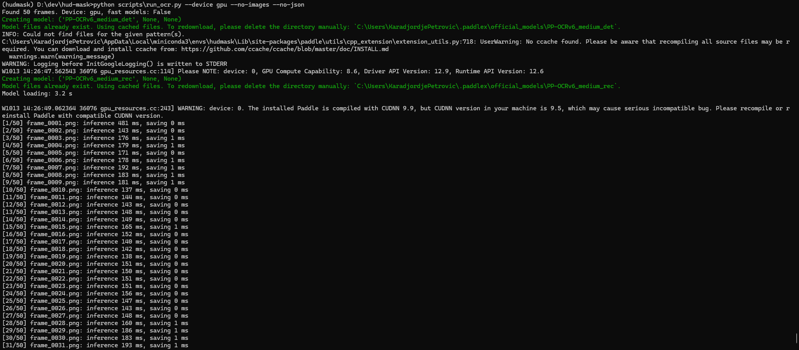
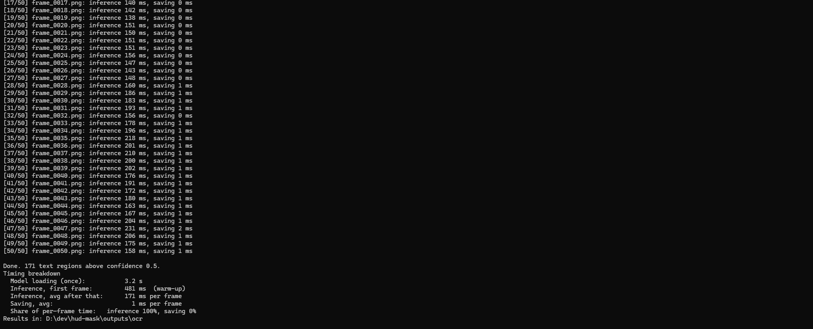
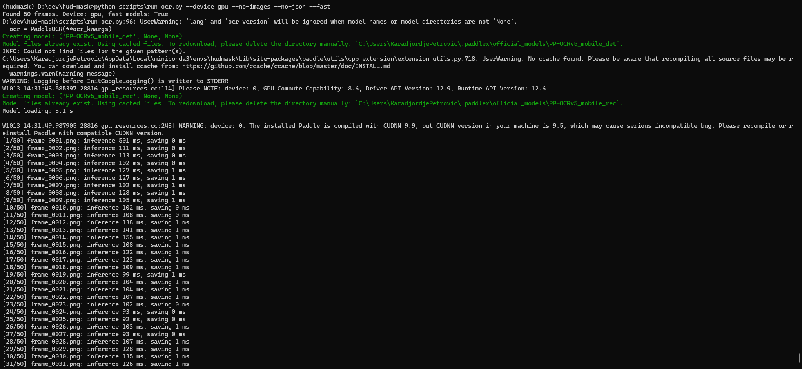
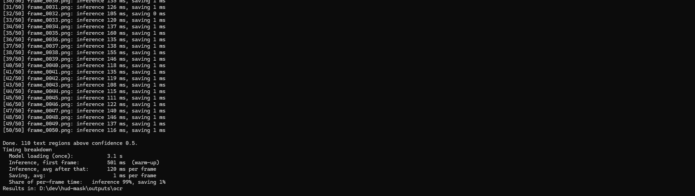
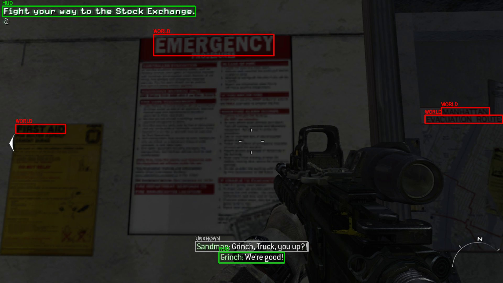

# Game Text Recognition

Detect on-screen text in game frames and separate **HUD text** (UI overlays such as objectives, subtitles, compass, ammo counters) from **in-world text** (signs, posters, labels that are part of the 3D scene).

The end goal is a per-frame **HUD mask**: a pixel mask of everything that is drawn on top of the scene rather than being part of it. That mask feeds into monocular depth estimation work (see [realtime-depth-optimization](https://github.com/karadjordjepetrovic/realtime-depth-optimization)), where HUD overlays produce wrong depth values and distort error metrics.

## Status

> **OCR now runs on the GPU at about 172 ms per 1080p frame end to end with the accurate models, down from about 15 seconds on CPU (roughly 90× faster), with identical results. The small mobile models bring it to about 121 ms, but find fewer text regions.**
> **A first rule-based classifier now labels each detected text as HUD, in-world or unknown, and writes a per-frame HUD mask.**
> Next: a static-pixel mask for non-text HUD (compass, minimap, crosshair), measure what the mobile models miss, try lower detection resolution.

What works today:

- Extracting frames from a gameplay video
- Running OCR (text detection + recognition) on every frame with [PaddleOCR](https://github.com/PaddlePaddle/PaddleOCR), on CPU or GPU
- Saving per-frame results: boxed preview images, raw JSON, and one CSV with every detected text region
- A timing breakdown per stage (model loading, inference, saving)
- Classifying each detection as HUD, in-world or unknown from how it moves across frames, with a black/white HUD mask per frame

## Performance

50 frames at 1920×1080 from a first-person shooter, same machine (NVIDIA GeForce RTX 3070).

| Version | Inference per frame | Saving per frame | Total per frame | Text regions found |
|---|---|---|---|---|
| v1: CPU baseline (oneDNN off) | 15,319 ms | not timed separately | ~15.3 s | 171 |
| v2: GPU (`--device gpu`) | 175 ms | 213 ms | 388 ms | 171 |
| v3: GPU, CSV only (`--device gpu --no-images --no-json`) | 171 ms | 1 ms | **172 ms** | 171 |
| v4: v3 + mobile models (`--fast`) | 120 ms | 1 ms | **121 ms** | **110** (−36%) |

Inference averages exclude the first (warm-up) frame, which takes about 480–500 ms on GPU. v1–v3 use `PP-OCRv6_medium` models; v4 uses `PP-OCRv5_mobile`.

v1–v3 found the same 171 text regions, so those steps changed only the speed. v4 does not: it is a speed/accuracy trade-off.

**What each step showed:**

- **v1 → v2: move inference to the GPU.** Inference dropped from 15.3 s to 175 ms per frame (~87×). This also revealed a new bottleneck: writing the boxed preview PNG and JSON per frame (213 ms) took longer than the model itself, 54% of per-frame time.
- **v2 → v3: stop writing per-frame preview files.** Saving dropped from 213 ms to 1 ms, and total per-frame time more than halved (388 → 172 ms, 2.3×). Inference is now essentially the whole cost again. The CSV with every detection is still written, so no results are lost; the previews are only needed for visual inspection.
- **v3 → v4: switch to the small mobile models.** Inference dropped from 171 to 120 ms (1.4× faster, about 127× faster than the CPU baseline), but the run found 110 text regions instead of 171. Whether the 61 missing regions are real text (HUD counters, signs) or noise that the medium models also picked up (textures misread as "III" or "000") is not yet measured. That decides whether the mobile models are usable for the HUD mask, so the medium models remain the default until it is.

Model loading took 29.0 s on the first GPU run and 3.2 s on the next one. The flags don't cause this: the first GPU run in a fresh environment does one-time CUDA/cuDNN initialization, and later runs benefit from caches.

**Takeaway:** at 172 ms per frame (~6 fps), the pipeline is limited by the OCR model itself, so further gains have to come from the model. Smaller models give ~8 fps at a measurable accuracy cost. Lower detection resolution and TensorRT are the next options to evaluate, each checked against the same 171-region baseline.

<details>
<summary>Raw terminal output</summary>

CPU baseline:


GPU:


GPU, CSV only:




GPU, CSV only, mobile models:




</details>

### Why the CPU baseline was slow

| Factor | Effect |
|---|---|
| CPU inference instead of GPU | The largest cost by far |
| oneDNN (Intel CPU acceleration) disabled | Required to avoid a crash in recent PaddlePaddle CPU builds on Windows |
| "Medium" accuracy models on full 1080p frames | Accurate but heavy |

## Project layout

```
game-text-recognition/
├── docs/benchmarks/         ← terminal output from benchmark runs
├── examples/                ← a few sample results shown in this README
├── data/
│   ├── gameplay.mp4         ← your recording (not in git)
│   └── frames/              ← extracted frames (not in git)
├── outputs/                 ← results (not in git)
│   ├── ocr/
│   │   ├── images/          ← frames with detected text boxed
│   │   ├── json/            ← raw OCR output per frame
│   │   └── summary.csv      ← one row per detected text region
│   └── hud/
│       ├── images/          ← frames with boxes coloured by label
│       ├── masks/           ← black/white HUD mask per frame
│       └── classified.csv   ← every detection with label and reason
├── scripts/
│   ├── extract_frames.py    ← video → PNG frames (OpenCV)
│   ├── run_ocr.py           ← OCR over all frames + timing report
│   ├── classify_hud.py      ← HUD vs in-world classification + HUD masks
│   └── make_examples.py     ← copy sample results into examples/
├── requirements.txt         ← CPU install
└── requirements-gpu.txt     ← GPU install (NVIDIA, CUDA 12.6 build)
```

The full gameplay footage and outputs are not included in the repository (size and copyright). `examples/` holds a few sample frames and the CSV from one run. Use your own recordings to reproduce.

## Setup (Windows)

1. Install [Miniconda](https://docs.anaconda.com/miniconda/) and open **Anaconda Prompt**.
2. Use the free conda-forge channel:
   ```
   conda config --add channels conda-forge
   conda config --remove channels defaults
   conda config --set channel_priority strict
   ```
3. Create and activate an isolated environment:
   ```
   conda create -n hudmask python=3.11 -y
   conda activate hudmask
   ```
4. Install the packages, **either** for an NVIDIA GPU (recommended):
   ```
   pip install -r requirements-gpu.txt
   ```
   **or** for CPU only:
   ```
   pip install -r requirements.txt
   ```
   The GPU build bundles its own CUDA libraries inside the environment. It needs a recent NVIDIA driver (`nvidia-smi` shows the highest CUDA version your driver supports; it must be 12.6 or higher). For other CUDA versions, see the [PaddlePaddle install page](https://www.paddlepaddle.org.cn/en/install/quick).

## Usage

From the project root, with the `hudmask` environment active:

1. Put a gameplay recording at `data/gameplay.mp4`, then extract frames (1 per second, max 50):
   ```
   python scripts/extract_frames.py
   ```
   Options: `--fps 2`, `--max-frames 100`, `--width 1920` (downscale), `--video path/to/other.mp4`.

2. Run OCR on the GPU:
   ```
   python scripts/run_ocr.py --device gpu
   ```
   Leave out `--device gpu` to run on CPU. The first run downloads the OCR models (about 100 MB). At the end the script prints a timing breakdown.

   Other options (being evaluated in the next commits):
   - `--fast`: small mobile models (~1.4× faster on GPU, but finds fewer text regions)
   - `--det-size 960`: run detection on a downscaled frame
   - `--no-images --no-json`: only write the CSV (recommended for speed; ~2.3× faster per frame on GPU)
   - `--mkldnn`: re-enable oneDNN on CPU, on PaddlePaddle versions without the crash

3. Classify the detections as HUD, in-world or unknown, and write the HUD masks:
   ```
   python scripts/classify_hud.py
   ```
   It reads `outputs/ocr/summary.csv` by default; use `--csv path/to/other.csv` to classify a different run.

## HUD vs in-world classification

OCR only says "there is text here". Whether that text is HUD or part of the world shows in **how it moves across frames**:

- **HUD text is glued to the screen.** It stays at the same pixel position while the camera moves.
- **In-world text is glued to the world.** When the camera moves, the same text appears at a different screen position.

`classify_hud.py` turns this into rules:

1. Ignore detections below 0.8 confidence (mostly textures misread as text).
2. Link boxes in consecutive frames that overlap by at least 50% (IoU ≥ 0.5) into **tracks**. Matching is on position only, because HUD text can change in place (an ammo counter going 30 → 29).
3. **HUD:** a track that stays in place for 2 or more frames *while the camera moves*. Camera motion is the mean pixel difference between consecutive frames, downscaled 8× and in greyscale. Without this check, a sign would also look static whenever the player stands still.
4. **In-world:** the same text (fuzzy match, tolerating OCR typos like "SECURITY" / "DECURITY") appears in a nearby frame at a clearly different position.
5. **Unknown:** seen only once, or only while the camera was still. The classifier does not guess.

One special case: when a new subtitle line appears, the old line moves straight up with the same left/right edges and size. Text in the 3D world almost never moves like that, so this pattern is marked unknown instead of in-world.

### Results

Input: the mobile-model OCR run (v4), 50 frames sampled at 1 fps, 97 detections above 0.8 confidence.

| Label | Count |
|---|---|
| HUD | 35 |
| In-world | 26 |
| Unknown | 36 |

Camera motion between consecutive frames: min 7.6, median 30.7, max 74.0 (threshold 8.0), so 47 of 49 frame pairs counted as "camera moved".

On the medium-model OCR output (144 detections above 0.8), a manual review of every label found no HUD/in-world mix-ups: the objective line, "Objectives Updated.", subtitles and an ammo-style counter (same position in 14 frames) were labelled HUD; signs such as "PUBLIC NOTICE", "MANHATTAN" and "SECURITY NOTICE" were labelled in-world.




### Known limitations

- **Compass letters are mostly "unknown".** They are HUD, but they slide along the compass bar as the player turns, so they never stay in place. A static-pixel mask (pixels that do not change while the camera moves) is the planned fix, and it also covers non-text HUD such as the minimap and crosshair.
- **Text seen only once cannot be decided.** Sampling at 1 fps makes this common; extracting at a higher rate (`extract_frames.py --fps 5`) gives each text more chances to show how it moves.
- **Thresholds are hand-tuned** on one game. Ground truth from Unreal Engine 5 captures (frames rendered with and without UI) is planned to measure accuracy properly.

## Example output

Raw OCR output on sample frames, before classification. HUD text (objective, subtitles, compass, counter) and in-world text (signs, notices) are both found.


All detected text regions from the run: [`examples/summary.csv`](examples/summary.csv)

## Early observations

From a first run over 50 frames of a first-person shooter:

- HUD text is consistently detected and read correctly: objectives, subtitles, compass letters and counters.
- HUD elements appear at the **same screen position across many frames**, while in-world text (signs, notices) moves as the camera moves. This is the main signal for the HUD vs in-world classification.
- Low-confidence detections are mostly textures misread as text, and a higher confidence threshold removes most of them.

## Roadmap

- [x] CPU OCR baseline with timing breakdown
- [x] GPU inference (~85× faster than the CPU baseline, identical results)
- [x] Remove the file-writing bottleneck: CSV-only mode (388 → 172 ms per frame)
- [ ] Asynchronous preview saving (keep previews without slowing the main loop)
- [x] Speed comparison, model size: mobile models 172 → 121 ms per frame, 171 → 110 regions
- [ ] Measure which text regions the mobile models miss (real text vs noise)
- [ ] Speed comparison, detection resolution (`--det-size`)
- [x] Track text boxes across frames (position-based, IoU)
- [x] Classify HUD vs in-world text, first version: position stability + camera motion + same-text-moved rule
- [ ] Better camera motion signal: optical flow inside each box vs global flow
- [ ] Static-pixel mask for non-text HUD (minimap, crosshair, icons)
- [ ] Combined per-frame HUD mask with temporal smoothing
- [ ] Ground-truth evaluation with Unreal Engine 5 captures (frames rendered with and without UI)
- [ ] Use the mask in depth estimation: exclude from metrics, inpaint before inference
- [ ] TensorRT optimization of the slowest stage
