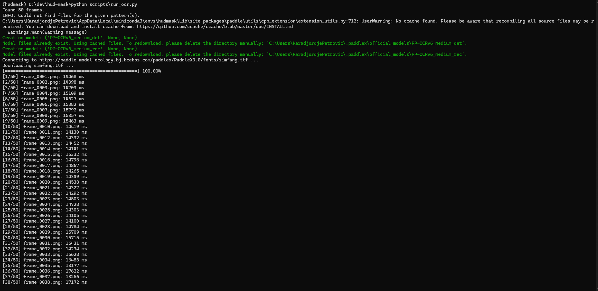
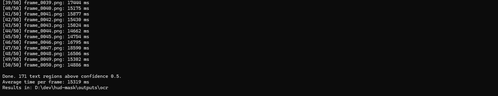
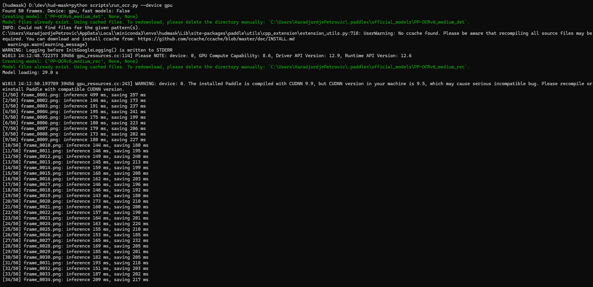
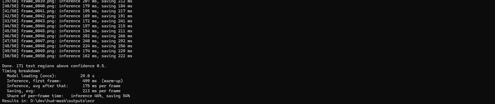
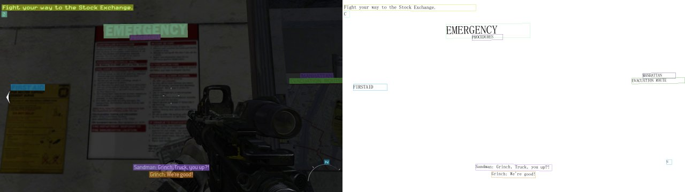
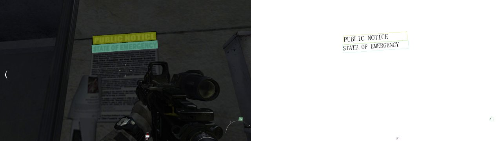

# Game Text Recognition

Detect on-screen text in game frames and separate **HUD text** (UI overlays such as objectives, subtitles, compass, ammo counters) from **in-world text** (signs, posters, labels that are part of the 3D scene).

The end goal is a per-frame **HUD mask**: a pixel mask of everything that is drawn on top of the scene rather than being part of it. That mask feeds into monocular depth estimation work (see [realtime-depth-optimization](https://github.com/karadjordjepetrovic/realtime-depth-optimization)), where HUD overlays produce wrong depth values and distort error metrics.

## Status

> **OCR now runs on the GPU: about 175 ms per 1080p frame, down from about 15 seconds on CPU (roughly 85× faster), with identical results.**
> Next: remove the file-writing bottleneck, try smaller models and lower detection resolution, then add the HUD vs in-world classification.

What works today:

- Extracting frames from a gameplay video
- Running OCR (text detection + recognition) on every frame with [PaddleOCR](https://github.com/PaddlePaddle/PaddleOCR), on CPU or GPU
- Saving per-frame results: boxed preview images, raw JSON, and one CSV with every detected text region
- A timing breakdown per stage (model loading, inference, saving)

## Performance

50 frames at 1920×1080 from a first-person shooter, `PP-OCRv6_medium` detection and recognition models, same machine (NVIDIA GeForce RTX 3070).

| Version | Inference per frame | Speed-up | Text regions found |
|---|---|---|---|
| v1: CPU baseline (oneDNN off) | 15,319 ms | 1× | 171 |
| v2: GPU (`--device gpu`) | **175 ms** (182 ms incl. warm-up) | **~85×** | 171 |

Both runs found the same 171 text regions, so moving to the GPU changed the speed but not the results.

GPU run breakdown:

| Stage | Time |
|---|---|
| Model loading (once per run) | 29.0 s |
| Inference, first frame (warm-up) | 499 ms |
| Inference, average after warm-up | 175 ms |
| Saving preview image + JSON, average | 213 ms |

**The bottleneck has moved.** On CPU, inference was almost the whole cost. On GPU, writing the boxed preview PNG and JSON per frame (213 ms) now takes longer than the model itself (175 ms), 54% of per-frame time. Skipping or deferring those writes is the next optimization.

<details>
<summary>Raw terminal output</summary>

CPU baseline:




GPU:




</details>

### Why the CPU baseline was slow

| Factor | Effect |
|---|---|
| CPU inference instead of GPU | The largest cost by far |
| oneDNN (Intel CPU acceleration) disabled | Required to avoid a crash in recent PaddlePaddle CPU builds on Windows |
| "Medium" accuracy models on full 1080p frames | Accurate but heavy |

## Project layout

```
game-text-recognition/
├── docs/benchmarks/         ← terminal output from benchmark runs
├── examples/                ← a few sample results shown in this README
├── data/
│   ├── gameplay.mp4         ← your recording (not in git)
│   └── frames/              ← extracted frames (not in git)
├── outputs/ocr/             ← results (not in git)
│   ├── images/              ← frames with detected text boxed
│   ├── json/                ← raw OCR output per frame
│   └── summary.csv          ← one row per detected text region
├── scripts/
│   ├── extract_frames.py    ← video → PNG frames (OpenCV)
│   ├── run_ocr.py           ← OCR over all frames + timing report
│   └── make_examples.py     ← copy sample results into examples/
├── requirements.txt         ← CPU install
└── requirements-gpu.txt     ← GPU install (NVIDIA, CUDA 12.6 build)
```

The full gameplay footage and outputs are not included in the repository (size and copyright). `examples/` holds a few sample frames and the CSV from one run. Use your own recordings to reproduce.

## Setup (Windows)

1. Install [Miniconda](https://docs.anaconda.com/miniconda/) and open **Anaconda Prompt**.
2. Use the free conda-forge channel:
   ```
   conda config --add channels conda-forge
   conda config --remove channels defaults
   conda config --set channel_priority strict
   ```
3. Create and activate an isolated environment:
   ```
   conda create -n hudmask python=3.11 -y
   conda activate hudmask
   ```
4. Install the packages, **either** for an NVIDIA GPU (recommended):
   ```
   pip install -r requirements-gpu.txt
   ```
   **or** for CPU only:
   ```
   pip install -r requirements.txt
   ```
   The GPU build bundles its own CUDA libraries inside the environment. It needs a recent NVIDIA driver (`nvidia-smi` shows the highest CUDA version your driver supports; it must be 12.6 or higher). For other CUDA versions, see the [PaddlePaddle install page](https://www.paddlepaddle.org.cn/en/install/quick).

## Usage

From the project root, with the `hudmask` environment active:

1. Put a gameplay recording at `data/gameplay.mp4`, then extract frames (1 per second, max 50):
   ```
   python scripts/extract_frames.py
   ```
   Options: `--fps 2`, `--max-frames 100`, `--width 1920` (downscale), `--video path/to/other.mp4`.

2. Run OCR on the GPU:
   ```
   python scripts/run_ocr.py --device gpu
   ```
   Leave out `--device gpu` to run on CPU. The first run downloads the OCR models (about 100 MB). At the end the script prints a timing breakdown.

   Other options (being evaluated in the next commits):
   - `--fast`: small mobile models
   - `--det-size 960`: run detection on a downscaled frame
   - `--no-images --no-json`: only write the CSV (removes the current bottleneck)
   - `--mkldnn`: re-enable oneDNN on CPU, on PaddlePaddle versions without the crash

## Example output

Detected text boxed on sample frames. HUD text (objective, subtitles, compass, counter) and in-world text (signs, notices) are both found; telling them apart is the next step.





All detected text regions from the run: [`examples/summary.csv`](examples/summary.csv)

## Early observations

From a first run over 50 frames of a first-person shooter:

- HUD text is consistently detected and read correctly: objectives, subtitles, compass letters and counters.
- HUD elements appear at the **same screen position across many frames**, while in-world text (signs, notices) moves as the camera moves. This is the main signal for the HUD vs in-world classification.
- Low-confidence detections are mostly textures misread as text, and a higher confidence threshold removes most of them.

## Roadmap

- [x] CPU OCR baseline with timing breakdown
- [x] GPU inference (~85× faster than the CPU baseline, identical results)
- [ ] Remove the file-writing bottleneck (optional/async preview saving)
- [ ] Speed comparison: model size (`--fast`) and detection resolution (`--det-size`)
- [ ] Track text boxes across frames
- [ ] Classify HUD vs in-world text (screen-space position stability, optical flow vs camera motion, geometry)
- [ ] Static-pixel mask for non-text HUD (minimap, crosshair, icons)
- [ ] Combined per-frame HUD mask with temporal smoothing
- [ ] Ground-truth evaluation with Unreal Engine 5 captures (frames rendered with and without UI)
- [ ] Use the mask in depth estimation: exclude from metrics, inpaint before inference
- [ ] TensorRT optimization of the slowest stage
